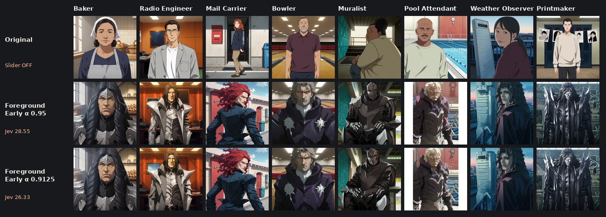
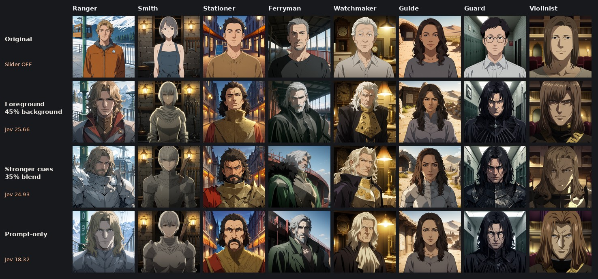

# Anima Final Boss RAW192

The **Final Boss research default** is soft foreground weighting with a **0.45 background floor**, using the saved RAW192 particle adapter at **early α 0.95**. This setting scored **33.71** on the development panel and **28.55** on eight separate confirmation cases. Use the shared early α 2/3 comparison below when comparing training techniques.

[Leaderboard summary](../leaderboard.md) · [Default manifest and exact per-step gains](default.json) · [Public RAW checkpoints](https://huggingface.co/ntc-ai/anima-final-boss-research) · [Per-case results and prompts](results.json)



## Training comparison

Each scored row uses 192 stock ParticleGAN EMPF updates and eight matched cases at 512 × 512, ten native Euler steps, and CFG 1. The score is the equal-case mean of `max(0, Boss_ON − Boss_OFF) × (1 − image_damage)²`, shown on a 0–100 scale. Jev judges character design and visible damage separately. The structural check also runs at each quarter of training. [Jev rubrics](rubrics.json)

This table covers the original control and dose comparisons. The results JSON includes the later matched ablations and their RAW fingerprints. [Current ranking](../leaderboard.md#training-techniques) · [Machine-readable scores](results.json)

| Training target | Early α 2/3 | Constant α 0.6375 |
| --- | ---: | ---: |
| Soft foreground weighting, 0.45 background floor | **25.66** | 13.06 |
| Soft foreground weighting plus 35% stronger cues | 24.93 | **16.90** |
| Paired scene and lighting contexts, 50% blend, 0.65 floor | 22.23 | 11.58 |
| Background-only scene and lighting projection, 0.45 floor | 22.22 | 11.51 |
| Soft foreground weighting plus 85% stronger cues, 0.45 floor | 21.77 | 14.39 |
| Paired scene and lighting contexts, 50% blend, 0.45 floor | 21.41 | 11.40 |
| Whole-image scene and lighting projection, 0.65 floor | 18.74 | 13.72 |
| Prompt-only control | 18.32 | Unmeasured |
| Earlier soft foreground weighting, 0.65 floor | 17.83 | 11.30 |
| Training on adapter rollout states, 0.45 floor | 11.61 | 5.49 |
| Soft foreground weighting plus 85% stronger cues, 0.65 floor | Unmeasured | 13.91 |



[Matched constant-strength samples](shared-constant.jpg)

The 35% blend raised the constant-strength score from **13.06 to 16.90**, and its early-strength score was **0.73** points below the shared early leader. The 0.80 background-floor arm failed the structural check at both shared strengths. A stronger 1.30 target-dose arm stopped at update 96 after a structural failure. Each technique was fit at one initialization seed. The eight additional cases confirm the selected default strength on the same checkpoint and have two qualified settings out of nine attempted.

## Replay the default

Run from the Anima checkout with the [pinned native environment](../../configs/anima/requirements.lock). Use the official converted Anima Turbo v1.1 model. If you need to prepare it, run `python -m release_tools.prepare_model --output "$ANIMA_MODEL"`.

```sh
python -m release_tools.final_boss_replay --model "$ANIMA_MODEL" --out final-boss.png
```

The command loads the revision-pinned RAW artifact and verifies its SHA-256. It renders the `baker` confirmation case by default. Use `--case ranger` for a development example or `--checkpoint` for a local copy of the same RAW artifact. The JSON beside the PNG records the prompt, seed, model identity, checkpoint digest, native sigma grid, and effective strengths. Current Anima source reproduced all eight default confirmation PNGs byte for byte on CUDA.

## Source for the trained targets

On each frozen neutral or positive trajectory state, subtract the neutral velocity from the generic positive velocity. Multiply that edit by `0.45 + 0.55 × foreground_matte`, restore its original L2 norm, and add it back to the neutral velocity. The cue blend first interpolates 35% toward a stronger positive contrast evaluated at the **same latent and timestep**. The capture source reproduced all 120 archived training fields exactly for each recipe. Each cache uses six prompt pairs, two trajectories, and ten steps per trajectory.

[Target capture and native admission source](../../release_tools/final_boss_targets.py) · [Exact training prompts, seeds and pinned mattes](training-pairs.json) · [Default replay source](../../release_tools/final_boss_replay.py)

```sh
python -m release_tools.final_boss_targets --model "$ANIMA_MODEL" --out targets/soft-floor45
python -m release_tools.final_boss_targets strong-boss-45-mix35 \
  --model "$ANIMA_MODEL" --out targets/strong-boss-45-mix35
```

The timed recipes apply the 35% cue blend only at positions 0–2 or 7–9. The two-cue recipe averages the two positive-minus-neutral responses at each frozen state before taking the 35% blend. All three use the same soft foreground mask and restore the original per-field L2 norm. [Exact alternate prompts](ablations/two-cue-prompts.json) · [Leaderboard evidence](../leaderboard.md)

```sh
for recipe in strong-cues-early3 strong-cues-late3 diverse-mean35; do
  python -m release_tools.final_boss_targets "$recipe" \
    --model "$ANIMA_MODEL" --out "targets/$recipe"
done
```

A fresh CUDA run reproduced all **360** archived fields across these three recipes. Matching fields included embeddings, latents, neutral and positive velocities, timesteps, and trajectory positions. All three fresh caches passed runtime admission. [Native verification](ablations/cue-native-source-verification.json)

Pass the resulting `TargetCache` to [scoped training](../explicit-fresh-initialization.md), with `variation="character-final-boss"` and `native_admission=lambda request: verify_native(runtime, cache, request)`. Keep the fit at `seed=1`, `batch_size=2`, `total_steps=192`, `response_scale=1`, `sigma=1`, `critic_width=32`, `lr=0.00075`, `d_lr_mult=12`, `prior_lr_mult=40`, and `ema_decay=None`. Use fresh scoped initialization for a new cohort. Save RAW at 48, 96, 144, and 192 and check the matched rendered images before continuing past each checkpoint. The recorded experiment used [this Anima source](https://github.com/HyperGAN/anima-particle-sliders/tree/c4b0e86e78670f21ffa5e7545b244d0f9e63cea6), [this core source](https://github.com/HyperGAN/particle-sliders/tree/507168a241e237fc3d5f1032a8137196fa3c3562), and ParticleGAN 0.11.1. Compare future cohorts on the same development cases at both shared strengths.

Related research includes teacher mixing [#278](https://github.com/HyperGAN/particle-sliders/pull/278), [Concept Sliders](https://www.ecva.net/papers/eccv_2024/papers_ECCV/papers/05660.pdf) and contrast isolation [#216](https://github.com/HyperGAN/particle-sliders/pull/216), nuisance projection [#254](https://github.com/HyperGAN/particle-sliders/pull/254), and rollout comparison [#246](https://github.com/HyperGAN/particle-sliders/pull/246). The trained Anima recipes are native adaptations.

## Denoising-position exposure

Start with the soft-foreground capture above. The following builds each cache and records the expected per-position draws from the stock sampler. Pass the new cache to the same scoped training options and native verifier above. Validate the actual exposure counts in the completed FULL checkpoint and evaluate the corresponding RAW192 at both shared strengths. [Exposure source](../../release_tools/final_boss_exposure.py) · [Frozen protocol](ablations/phase-exposure-protocol.json)

```sh
for recipe in exposure-opening4 exposure-middle4; do
  python -m release_tools.final_boss_exposure targets/soft-floor45 "$recipe" \
    "targets/$recipe" --receipt "targets/$recipe-sampler.json"
done
```

## Regional stronger cues

The regional recipes keep both teacher trajectories and change the stronger cue only within the allowed mask. They match the baseline edit norm and the whole-field cue's distance from the baseline at each position. The target capture and native admission use the same parameters and matte in each recipe. [Regional target source](../../release_tools/final_boss_targets.py) · [Field checks and protocol](ablations/regional-cue-protocol.json)

```sh
for recipe in regional-cue-matte regional-cue-dilated2; do
  python -m release_tools.final_boss_targets "$recipe" \
    --model "$ANIMA_MODEL" --out "targets/$recipe"
done
```

Independent CUDA capture matched the queued training targets bit for bit across both 120-field caches. Both recipes passed native admission. [CUDA verification](ablations/regional-cue-native-verification.json)

## Percentile-filtered teacher targets

These recipes retain both original trajectories. The active positions blend 35% of the norm-matched top 10% of the soft-foreground edit into the original dense edit and restore its per-field L2 norm. The command checks native admission on the saved cache. [Leaderboard comparison](../leaderboard.md#percentile-filtered-teacher-edits) · [Capture source](../../release_tools/final_boss_targets.py)

```sh
for recipe in sega-early35 sega-all35; do
  python -m release_tools.final_boss_targets "$recipe" \
    --model "$ANIMA_MODEL" --out "targets/$recipe"
done
```

Independent CUDA capture reproduced all 120 archived fields for each recipe and both caches passed native admission. The verification used the published capture source at `d058517`. [CUDA verification](ablations/sega-native-verification.json) · [Verified source](https://github.com/HyperGAN/anima-particle-sliders/blob/d058517532d00098fed181c89eea2ac1b364ffc6/release_tools/final_boss_targets.py)

## Matched ordinary attire

The matched-attire recipes use the published stronger Boss prompt and its same-scene ordinary outfit reference. The regional variant blends the matched-reference change into the character region and preserves the stronger cue's exterior values. [Exact prompt pairs](ablations/matched-attire-prompts.json) · [Regional field audit](ablations/regional-attire-field-audit.json) · [Leaderboard](../leaderboard.md#matched-ordinary-attire)

```sh
for recipe in matched-attire35 regional-attire35; do
  python -m release_tools.final_boss_targets "$recipe" \
    --model "$ANIMA_MODEL" --out "targets/$recipe"
done
```
