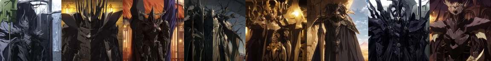
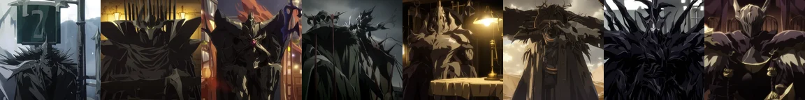
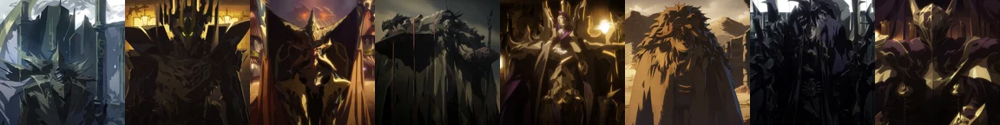
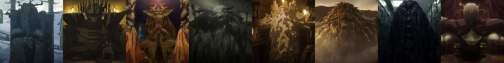

# Twelve-scene Final Boss development leaderboard

2026-11-25 06:49 UTC

[Distinct Boss ranking across characters](distinct-designs.md)

**Opening-four exposure at early α 1.15625** is the visual comparison reference. The table below ranks all recipes using the same formula.


[Blind finalist comparisons and case sensitivity](finalist-review.md)

255 settings from 20 trained recipes have all eight measurements. 16 recipes have finished the new search. Each row shows that recipe’s highest measured damage-adjusted Final Boss score across available strengths. Recipes with additional strengths still queued may move.

The sample strips show these cases from left to right — ranger, smith, stationer, ferryman, watchmaker, guide, guard, violinist.


| Rank | Training recipe | Schedule and α | Final Boss score ↑ | Boss gain ↑ | Damage ↓ | Matched samples |
| ---: | --- | --- | ---: | ---: | ---: | --- |
| 1 | Stronger cues at the final three teacher positions | early 1.15625 | 37.09 | 77.50 | 26.56 | [](samples/d442fca93d0c41a5bcdb4543bdc95db318c5a289648a2786e4ce65de47e9b101.webp) |
| 2 | Background-only scene and lighting projection, 0.45 floor | early 1.48438 | 35.42 | 77.62 | 29.91 | [](samples/74fbddfc796d039e19342e3f9cf392a5164faaf305520968f93ca3239400cd37.webp) |
| 3 | Paired scene and lighting contexts, 50% blend, 0.45 floor | constant 1.625 | 34.54 | 77.50 | 31.41 | [](samples/9e17143cf1967653b56d4dda12dda9a3b309df6adac07e8f47900ef991c56860.webp) |
| 4 | Extra training exposure at the middle four denoising positions | early 1.4375 | 34.39 | 76.00 | 27.09 | [](samples/d9d29020386e7258cfeae4414ab10470ff353c9e6b59ca3a012756dfa4d3e91f.webp) |
| 5 | Stronger cues at the first three teacher positions | early 1.3125 | 33.50 | 77.25 | 33.03 | [](samples/6a7211acae36d8895de03a0ba4756b507525594bb471a2c824895891518c653c.webp) |
| 6 | Six highest-divergence timestep positions | early 1.25 | 33.48 | 75.88 | 28.59 | [](samples/ef3e62ea19eec9890e5d467c1614ed7c028e19bf3d69d3e1e677a91d13230905.webp) |
| 7 | Extra training exposure at the opening four denoising positions | early 1.25 | 33.02 | 72.88 | 26.06 | [](samples/d70d807e7512117a3278aa046b1b8fe92e58888b354c6aa1c98e71265a3bc3e5.webp) |
| 8 | Prompt-only control · all 240 fields | early 1.25 | 31.79 | 75.38 | 30.09 | [](samples/175065fdf76950edf16b15a66b1b9441d9e2e1496dee9c06358bbd3bbabce983.webp) |
| 9 | Stronger Boss cues contrasted with matched ordinary attire | constant 1.34375 | 30.93 | 75.75 | 33.53 | [](samples/a7fb03678908dfb82188ab3154e559489fa35a2344cc832216c77a4724377e17.webp) |
| 10 | Soft foreground weighting plus 35% stronger Boss cues | early 1.0625 | 30.77 | 74.50 | 30.16 | [](samples/b0fc280276b939d08925646fc31d4f69e3be55b01ffe9d8909ed8daa32729b5b.webp) |
| 11 | Paired scene and lighting contexts, 50% blend, 0.65 floor | early 1.4375 | 28.87 | 73.75 | 31.97 | [](samples/010f266bec310a8a5781a9917e8680ac891f48b5fef7a2875a336ace8e8f458a.webp) |
| 12 | Soft foreground weighting, 0.45 background floor | early 1.3125 | 28.63 | 72.75 | 31.37 | [](samples/8dfd53b332720dc08c4299ccbf003fd98e99ac114eb1dfd2e164241f224b8b09.webp) |
| 13 | Soft foreground weighting with full-strength Boss cues | early 1.4375 | 27.28 | 73.00 | 33.94 | [](samples/252fc8bfac38b187eb98ff1af9b6d739c5da890f05a32161a40591928020cdee.webp) |
| 14 | Second qualified seed on the shared teacher scenes | early 1.25 | 27.20 | 73.62 | 34.75 | [](samples/ad74d8cd9fc2630325d431716e14289117fd6587faf26abeb4350213542dd3c3.webp) |
| 15 | Six evenly spaced timestep positions | early 1.40625 | 23.19 | 69.38 | 32.12 | [](samples/b4810c815c9689711fbaf8e1ff304ebf296341e843b93fdfdb0eb6be8528c6ef.webp) |
| 16 | Percentile-filtered blend at the first three teacher positions | constant 1.48438 | 23.08 | 68.25 | 34.09 | [](samples/7b7a79c753eb1e10077d0144dba13fc38a2bc3dad97c8c3e4f66a69f33f11b8d.webp) |
| 17 | Neutral trajectory only | early 1.625 | 12.87 | 57.12 | 33.09 | [](samples/a23ef775dd61debdf18c6d07dddf0b9b823f451df4b6c916d2fa46cd3ace6492.webp) |
| 18 | Soft foreground weighting plus a 35% blend of two averaged cues | early 0.666667 | 12.13 | 41.62 | 23.78 | [](samples/692300e3215adec41b09223dc4bd91c794025d290575dfba1ff6801205ac94db.webp) |
| 19 | Soft foreground weighting · prior incumbent recipe | early 0.666667 | 11.41 | 46.75 | 25.56 | [](samples/e62859f259300a06105346d6de8a261543c2726f888790bbda3136d84567f2e7.webp) |
| 20 | In-scene costume cue blend, 35% | early 0.666667 | 7.27 | 41.12 | 25.37 | [](samples/6a354e7241d0c9d01cd3057d29939ae743a739896ce1249f94338555d0eab4d5.webp) |

The JSON includes every measured setting, original and edited image hashes, per-case Jev ratings, sample strips, native gains, RAW checkpoint hashes and completed search paths. [All measurements](standings.json) · [Post-training handoff](../vibe12-post-training.md)

Reproduce the ranking from the repository root.

```sh
python -m release_tools.final_boss_damage_search docs/final-boss-raw192/vibe12/standings.json
```
