# Distinct Final Boss designs across characters

2026-11-25 07:52 UTC

**Default** · Stronger cues at the final three teacher positions · early α 1.15625 · 28.84/100 on eight development characters. [Replay settings and training targets](../default.json)

Opening-four exposure places **3 of 24** across matched characters, compared with position 9 on the per-image score. Its average design repetition is 35.7/100, compared with 49.0/100 for late cues. 15 of these recipes have completed the distinct-design alpha search. Remaining recipes enter at their best measured per-image strength.

Jev compares the character designs in each pair of finished images. It looks for repeated silhouettes, body construction, masks, costume shapes and visual motifs. A palette change or a different background alone carries little weight. On each pair, distinct bosses earn both per-image scores. If the same design repeats, the pair earns the stronger score. Jev’s continuous repetition rating interpolates between those outcomes. The per-image scores already account for matched Final Boss gain and visible damage. Zero-effect edits contribute zero.

Every row uses the same eight cases and the same RAW192 budget. Jev rates all 28 pairs in both image orders. Its repetition rating is an ordinal score on a 0–100 scale. The current alpha search uses this cross-character score on four search characters and on eight development characters for the final choice. [Saved alpha and search evidence](alpha-tuning/README.md)

| Rank | Recipe | Schedule and α | Distinct Boss score ↑ | Per-image score ↑ | Design repetition ↓ | Matched samples | RAW192 |
| ---: | --- | --- | ---: | ---: | ---: | --- | --- |
| 1 | Stronger cues at the final three teacher positions | Design-tuned · early 1.15625 | 28.84 | 37.09 | 49.0 | [](samples/d442fca93d0c41a5bcdb4543bdc95db318c5a289648a2786e4ce65de47e9b101.webp) | [RAW](https://huggingface.co/ntc-ai/anima-final-boss-research/resolve/4ebd99f8528b30e84e0232c5049f86f2eeb64e02/vibe12/late-cues/RAW000192.safetensors) |
| 2 | Extra training exposure at the middle four denoising positions | Design-tuned · early 1.4375 | 27.74 | 34.39 | 43.3 | [](samples/d9d29020386e7258cfeae4414ab10470ff353c9e6b59ca3a012756dfa4d3e91f.webp) | [RAW](https://huggingface.co/ntc-ai/anima-final-boss-research/resolve/4ebd99f8528b30e84e0232c5049f86f2eeb64e02/vibe12/shared-best-middle/RAW000192.safetensors) |
| 3 | Extra training exposure at the opening four denoising positions | Design-tuned · early 1.25 | 27.63 | 33.02 | 35.7 | [](samples/d70d807e7512117a3278aa046b1b8fe92e58888b354c6aa1c98e71265a3bc3e5.webp) | [RAW](https://huggingface.co/ntc-ai/anima-final-boss-research/resolve/4ebd99f8528b30e84e0232c5049f86f2eeb64e02/vibe12/shared-best-opening/RAW000192.safetensors) |
| 4 | Background-only scene and lighting projection, 0.45 floor | Design-tuned · early 1.48438 | 27.24 | 35.42 | 49.3 | [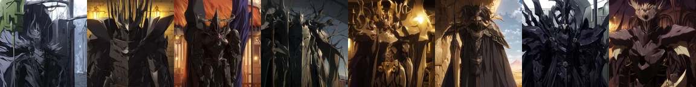](samples/74fbddfc796d039e19342e3f9cf392a5164faaf305520968f93ca3239400cd37.webp) | [RAW](https://huggingface.co/ntc-ai/anima-final-boss-research/resolve/4ebd99f8528b30e84e0232c5049f86f2eeb64e02/vibe12/soft45-background-orthogonal/RAW000192.safetensors) |
| 5 | Six highest-divergence timestep positions | Design-tuned · early 1.25 | 26.34 | 33.48 | 48.3 | [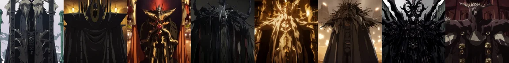](samples/ef3e62ea19eec9890e5d467c1614ed7c028e19bf3d69d3e1e677a91d13230905.webp) | [RAW](https://huggingface.co/ntc-ai/anima-final-boss-research/resolve/4ebd99f8528b30e84e0232c5049f86f2eeb64e02/vibe12/shared-best-divergence/RAW000192.safetensors) |
| 6 | Paired scene and lighting contexts, 50% blend, 0.45 floor | Design-tuned · early 1.15625 | 26.11 | 34.15 | 52.4 | [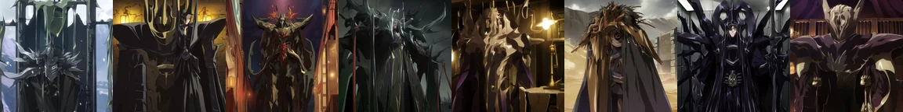](samples/591580ec3db70b22baaf606a213dfb523c97606d41a6ceaa52251a80104f4b24.webp) | [RAW](https://huggingface.co/ntc-ai/anima-final-boss-research/resolve/4ebd99f8528b30e84e0232c5049f86f2eeb64e02/vibe12/soft-contexts-45-blend50/RAW000192.safetensors) |
| 7 | Stronger cues at the first three teacher positions | Design-tuned · early 1.3125 | 25.55 | 33.50 | 52.4 | [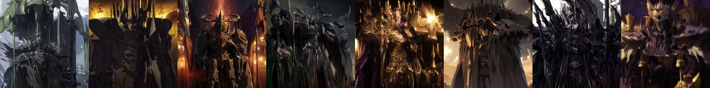](samples/6a7211acae36d8895de03a0ba4756b507525594bb471a2c824895891518c653c.webp) | [RAW](https://huggingface.co/ntc-ai/anima-final-boss-research/resolve/4ebd99f8528b30e84e0232c5049f86f2eeb64e02/vibe12/early-cues/RAW000192.safetensors) |
| 8 | Soft foreground weighting · prior incumbent recipe | Design-tuned · early 1.25 | 24.98 | 31.12 | 49.2 | [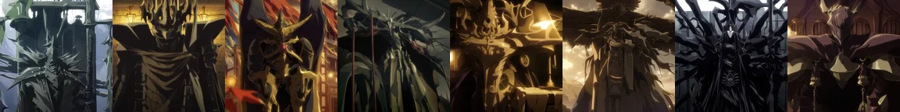](samples/a178d84adbde5a95f8d8ce8d1647812a7ea25c137ec2ed9721e2c958276c6af2.webp) | [RAW](https://huggingface.co/ntc-ai/anima-final-boss-research/resolve/4ebd99f8528b30e84e0232c5049f86f2eeb64e02/vibe12/incumbent-refit/RAW000192.safetensors) |
| 9 | Soft foreground weighting plus 35% stronger Boss cues | Design-tuned · early 1.0625 | 24.50 | 30.77 | 48.0 | [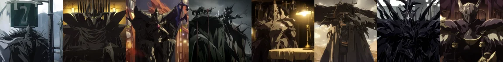](samples/b0fc280276b939d08925646fc31d4f69e3be55b01ffe9d8909ed8daa32729b5b.webp) | [RAW](https://huggingface.co/ntc-ai/anima-final-boss-research/resolve/4ebd99f8528b30e84e0232c5049f86f2eeb64e02/vibe12/strong-boss-45-mix35/RAW000192.safetensors) |
| 10 | Prompt-only control · all 240 fields | early 1.25 | 24.44 | 31.79 | 49.4 | [](samples/175065fdf76950edf16b15a66b1b9441d9e2e1496dee9c06358bbd3bbabce983.webp) | [RAW](https://huggingface.co/ntc-ai/anima-final-boss-research/resolve/4ebd99f8528b30e84e0232c5049f86f2eeb64e02/vibe12/shared-best-stock/RAW000192.safetensors) |
| 11 | Train on adapter rollout states, 0.45 floor | early 1.75 | 24.31 | 33.59 | 62.1 | [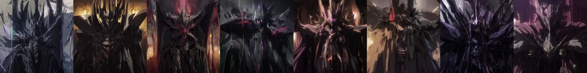](samples/a77034ac5a3efc989089ef21c2dc1bb2352b728920a17f082ae806f4dcdf332c.webp) | [RAW](https://huggingface.co/ntc-ai/anima-final-boss-research/resolve/4ebd99f8528b30e84e0232c5049f86f2eeb64e02/vibe12/soft45-adapter-rollout/RAW000192.safetensors) |
| 12 | Stronger Boss cues contrasted with matched ordinary attire | early 1.25 | 24.27 | 33.73 | 60.3 | [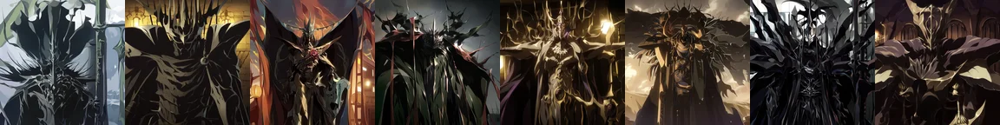](samples/0f1f201e72abdd2456ddaf489ccbe068b48a561427fb4fc408faade3175e7c89.webp) | [RAW](https://huggingface.co/ntc-ai/anima-final-boss-research/resolve/4ebd99f8528b30e84e0232c5049f86f2eeb64e02/vibe12/matched-attire/RAW000192.safetensors) |
| 13 | Soft foreground weighting, 0.45 background floor | early 1.3125 | 23.48 | 28.63 | 39.7 | [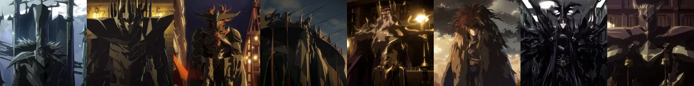](samples/8dfd53b332720dc08c4299ccbf003fd98e99ac114eb1dfd2e164241f224b8b09.webp) | [RAW](https://huggingface.co/ntc-ai/anima-final-boss-research/resolve/4ebd99f8528b30e84e0232c5049f86f2eeb64e02/vibe12/soft-floor45/RAW000192.safetensors) |
| 14 | Paired scene and lighting contexts, 50% blend, 0.65 floor | early 1.4375 | 22.21 | 28.87 | 53.0 | [](samples/010f266bec310a8a5781a9917e8680ac891f48b5fef7a2875a336ace8e8f458a.webp) | [RAW](https://huggingface.co/ntc-ai/anima-final-boss-research/resolve/4ebd99f8528b30e84e0232c5049f86f2eeb64e02/vibe12/soft-contexts-65-blend50/RAW000192.safetensors) |
| 15 | Qualified costume teachers with soft-foreground contexts | early 1.25 | 22.08 | 28.84 | 53.8 | [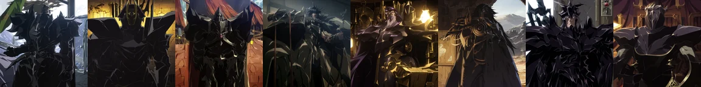](samples/2fffdda90b446bed3813ce3cf891b7dd0e14fedd058f3e3650374c2ffb86c7a6.webp) | [RAW](https://huggingface.co/ntc-ai/anima-final-boss-research/resolve/4ebd99f8528b30e84e0232c5049f86f2eeb64e02/vibe12/costume-teachers/RAW000192.safetensors) |
| 16 | Soft foreground weighting plus a 35% blend of two averaged cues | Design-tuned · early 1.125 | 21.63 | 25.58 | 40.2 | [](samples/5dfc79667e460e4efcc471ef192e435c047295d6f097da5d0d54dd7a20e57d51.webp) | [RAW](https://huggingface.co/ntc-ai/anima-final-boss-research/resolve/4ebd99f8528b30e84e0232c5049f86f2eeb64e02/vibe12/two-cue-average/RAW000192.safetensors) |
| 17 | Whole-image scene and lighting projection, 0.65 floor | Design-tuned · early 1.625 | 21.58 | 28.04 | 53.7 | [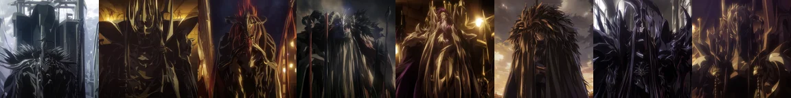](samples/dd80f8f951dc5353115008eb63514ecd3710b40558bfc4810d27fe917889a299.webp) | [RAW](https://huggingface.co/ntc-ai/anima-final-boss-research/resolve/4ebd99f8528b30e84e0232c5049f86f2eeb64e02/vibe12/soft-projection-65-blend50/RAW000192.safetensors) |
| 18 | Soft foreground weighting with full-strength Boss cues | Design-tuned · early 1.4375 | 21.26 | 27.28 | 51.0 | [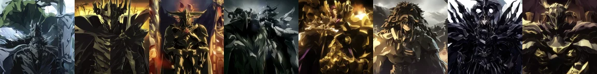](samples/252fc8bfac38b187eb98ff1af9b6d739c5da890f05a32161a40591928020cdee.webp) | [RAW](https://huggingface.co/ntc-ai/anima-final-boss-research/resolve/4ebd99f8528b30e84e0232c5049f86f2eeb64e02/vibe12/strong-boss-45-dose100/RAW000192.safetensors) |
| 19 | In-scene costume cue blend, 35% | early 1.34375 | 21.19 | 26.92 | 51.4 | [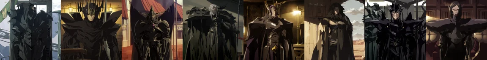](samples/d3e1a2cb40900ac0e42f7d8394089b2d2d67d7e9356de1e1c49df6b470e645c5.webp) | [RAW](https://huggingface.co/ntc-ai/anima-final-boss-research/resolve/4ebd99f8528b30e84e0232c5049f86f2eeb64e02/vibe12/in-scene-costume/RAW000192.safetensors) |
| 20 | Second qualified seed on the shared teacher scenes | Design-tuned · early 1.25 | 21.18 | 27.20 | 47.7 | [](samples/ad74d8cd9fc2630325d431716e14289117fd6587faf26abeb4350213542dd3c3.webp) | [RAW](https://huggingface.co/ntc-ai/anima-final-boss-research/resolve/4ebd99f8528b30e84e0232c5049f86f2eeb64e02/vibe12/shared-best-seed-split/RAW000192.safetensors) |
| 21 | Percentile-filtered blend at the first three teacher positions | constant 1.48438 | 19.51 | 23.08 | 41.2 | [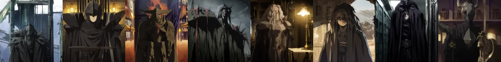](samples/7b7a79c753eb1e10077d0144dba13fc38a2bc3dad97c8c3e4f66a69f33f11b8d.webp) | [RAW](https://huggingface.co/ntc-ai/anima-final-boss-research/resolve/4ebd99f8528b30e84e0232c5049f86f2eeb64e02/vibe12/sparse-first/RAW000192.safetensors) |
| 22 | Six evenly spaced timestep positions | Design-tuned · early 1.40625 | 19.25 | 23.19 | 41.1 | [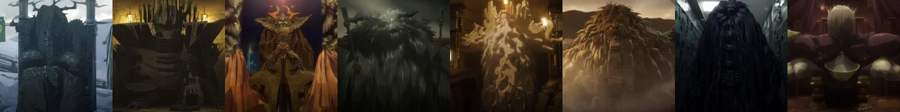](samples/b4810c815c9689711fbaf8e1ff304ebf296341e843b93fdfdb0eb6be8528c6ef.webp) | [RAW](https://huggingface.co/ntc-ai/anima-final-boss-research/resolve/4ebd99f8528b30e84e0232c5049f86f2eeb64e02/vibe12/shared-best-uniform-steps/RAW000192.safetensors) |
| 23 | Soft foreground weighting with subject APG | Design-tuned · early 1.25 | 13.58 | 16.29 | 52.1 | [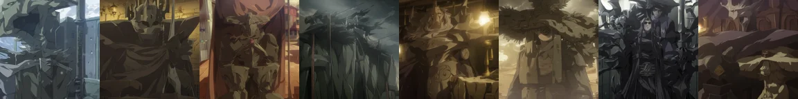](samples/82e5755d0ef52b1eea1c304553b453c1bb2d74af880af2d0fe2a5c2d37bebd9c.webp) | [RAW](https://huggingface.co/ntc-ai/anima-final-boss-research/resolve/4ebd99f8528b30e84e0232c5049f86f2eeb64e02/vibe12/subject-apg/RAW000192.safetensors) |
| 24 | Neutral trajectory only | early 1.625 | 10.79 | 12.87 | 51.7 | [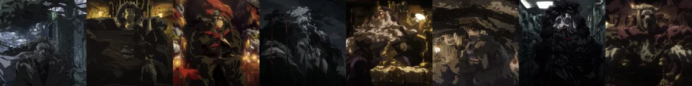](samples/a23ef775dd61debdf18c6d07dddf0b9b823f451df4b6c916d2fa46cd3ace6492.webp) | [RAW](https://huggingface.co/ntc-ai/anima-final-boss-research/resolve/4ebd99f8528b30e84e0232c5049f86f2eeb64e02/vibe12/shared-best-neutral-path/RAW000192.safetensors) |

## How the result depends on the characters

In a separate blind check Jev compared two four-character lineups as whole sets. It rated which lineup produced more individually recognizable Final Boss designs. Positive margins favor opening four over late cues. The two development partitions reuse the same eight images. The four search scenes are separate from those eight and were used during alpha selection.

| Matched characters | Opening-four preference margin |
| --- | ---: |
| Ranger, Smith, Stationer, Ferryman | +38.5 |
| Watchmaker, Guide, Guard, Violinist | -52.2 |
| Ranger, Stationer, Watchmaker, Guard | +5.5 |
| Smith, Ferryman, Guide, Violinist | -38.0 |
| Archivist, Bookkeeper, Botanist, Seamstress | -23.8 |

On the four search scenes, mean design repetition is 43.9/100 for opening four and 43.3/100 for late cues. The development advantage in variety depends on the characters.

Three preselected same-design examples from a separate historical confirmation set used different native renders of the same characters. Three different-design examples used the same art style. All six landed on the expected side of the scale in both image orders. These controls check whether the judge recognizes a repeat. Agreement with human rankings on new lineups remains unmeasured.

[Exact rubric, case pairs and lineups](design-range.json) · [Jev decision receipts](design-receipts.json.gz) · [Per-image rankings](README.md)

```sh
python -m release_tools.verify_final_boss_designs docs/final-boss-raw192/vibe12
```
