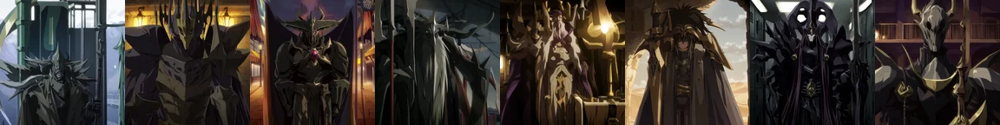
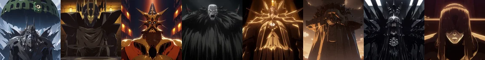

# Which Final Boss edit would Jev keep?

Jev favored **stronger cues at the final three teacher positions**. It led all five head-to-head comparisons. Extra training exposure at the opening four positions placed fifth among the six finalists. Both use the same corrected teachers and 192 training updates. Each network enters at its highest measured all-recipe score across strengths and schedules.

| Finished-edit rank | Training recipe | Early α | Preference margin | All-recipe score | Rank with one scene omitted |
| ---: | --- | ---: | ---: | ---: | ---: |
| 1 | Stronger cues at the final three teacher positions | 1.15625 | +25.85 | 37.09 | 1 |
| 2 | Background-only scene and lighting projection | 1.484375 | +14.92 | 35.42 | 2 |
| 3 | Extra training exposure at the middle four positions | 1.4375 | +3.41 | 34.39 | 3–5 |
| 4 | Stronger cues at the first three teacher positions | 1.3125 | +1.01 | 33.50 | 3–5 |
| 5 | Extra training exposure at the opening four positions | 1.25 | −1.67 | 33.02 | 3–5 |
| 6 | Six highest-divergence timestep positions | 1.25 | −43.51 | 33.48 | 6 |

Each recipe faces every other finalist across the same eight slider-off originals. Jev sees the original and two anonymous edits, then judges them again with the edit order reversed. The preference margin runs from −100 to +100. It averages the signed difference between the two presentations equally across cases and opponents. The margin depends on which recipes enter the comparison. The all-recipe score can be computed for a single candidate and continues to drive alpha search. [Ranked sample strips and search settings](README.md)

## Opening four against the leader

From left to right, the matched subjects are Ranger, Smith, Stationer, Ferryman, Watchmaker, Guide, Guard and Violinist.

**Late cues at early α 1.15625**

[](samples/d442fca93d0c41a5bcdb4543bdc95db318c5a289648a2786e4ce65de47e9b101.webp)

**Opening four at early α 1.25**

[](samples/d70d807e7512117a3278aa046b1b8fe92e58888b354c6aa1c98e71265a3bc3e5.webp)

The closest calls were Ranger, Smith and Ferryman. Each changed direction or tied when the images switched places. On Guide, opening four produced a tall, mechanical-looking figure with a central eye. On Violinist, it produced a shadowed face with a thin glowing outline. Jev preferred the late-cue edits in both presentation orders on those two scenes. Opening four rises to third among the six when Violinist is omitted. Late cues holds first whichever single scene is omitted. Jev also preferred opening four at early α 1.25 to the visually nominated α 1.15625 on average. The weaker strength did better on Stationer in both orders.

## What changed in the question

The first question emphasized how readily the character could be recognized as a final opponent. That recovered the full order on the subtle-effect panel, but it still preferred the visibly overdriven prompt-only edit on the second panel. The revised question asks which **finished** edit to keep. When both designs convey Final Boss, Jev compares how well their forms, surfaces and focal details read. It explicitly allows deliberate stylization, dramatic lighting, masks and nonhuman anatomy.

| Comparison with the two previously rated panels | Agreements across eight stated preferences |
| --- | ---: |
| Existing scalar effect and damage score | 5/8 |
| First side-by-side question | 6/8 |
| Revised finished-edit question | 8/8 |

The first panel supplies six pairwise directions from the order **4, 1, 3, 2**. The second supplies two from **2 and 3 above 1**. The user's preference between 2 and 3 was approximate and was excluded from this count. Two successful distinctions were narrow: #1 over #3 on the first panel (+1.6) and #3 over #1 on the second (+2.6). These are calibration results on examples used to develop the question. Prediction of new human preferences still needs independently rated scenes.

The revised question chose the edited character over slider-off on all three effect controls. It also preferred the intact Boss image in both presentation orders on six controlled degradations across Watchmaker, Guide and Guard. The degradations shift one color channel or displace horizontal bands in the same finished Boss illustration. Across the six-recipe comparison, the two orders agreed strictly on 99 of 120 individual matchups. The leaderboard displays both the aggregate and the cases where position affected the answer. [Exact questions, case outcomes, and image hashes](preferences.json) · [Bound Jev responses](preference-receipts.json.gz)

Replay the receipt checks and both rankings from the repository root.

```sh
python -m release_tools.verify_final_boss_preferences docs/final-boss-raw192/vibe12
python -m release_tools.final_boss_damage_search docs/final-boss-raw192/vibe12/standings.json
```
