# Post-training the 512-update Final Boss slider

No arm met the proposal's bar for a win, and cleaner teachers did not lower damage. Across seven matched pairs, training on five less damaged Boss teachers changed damage by +0.4 points on average and lowered it once. It raised Boss gain by 3.7 points and the distinct Boss score by 2.4, with five of seven pairs positive. Damage rose over the untouched parent in sixteen of eighteen post-trained checkpoints. At the published generator rate the score depends more on which checkpoint is measured than on the targets: the sixteen checkpoints at that rate range from 20.27 to 30.83 against the parent's 27.39. Forks that restart the critic collapsed toward one design, and carrying the parent's critic prevented that. One arm stopped on a structural failure. [Matched samples and every searched strength](http://100.90.104.57:8797/post-training-leaderboard.html?metric=design) · [The proposal this tests](../final-boss-raw192/vibe12-post-training.md)

Every row starts from the PG 0.12.0 Final Boss RAW512, SHA-256 `d3b828cfa4bccf0c20dc11587ed1080cc3eda2684a424e0079b334ed15e2b377`, trained on the late-cues targets at G 0.00075, D 0.009 and particle 0.03. Each RAW had its own constant-alpha search on four characters. That alpha was frozen before the eight ranking characters. This is the measurement behind the [constant-alpha leaderboard](../leaderboard.md), so these rows compare directly with it. Boss gain is ON minus OFF distinction and damage is Jev's visible-damage severity, both out of 100. Weights are the raw current weights. No EMA is involved.

## What ON should mean

The sections below this one rank by the distinct Boss score. That score rewards ever stronger designs, so it chose strengths where many images were shattered or collapsed, and its damage question could not see it. Reviewing the images changed the objective. Switched on, the slider should give a final boss that is not broken. A wilder boss is the user's choice of a higher strength. [Board with every image and reading](http://100.90.104.57:8797/working-leaderboard.html)

Each image scores effect times quality, with the same discount for repeated designs.

- **Effect** rises from 0 for an ordinary character to 1 once the character reads as a distinctive endgame antagonist, and does not grow past that.
- **Quality** is the lowest of three readings. How cleanly the image is drawn is read by Mercury Decide on four 256-pixel tiles at native resolution, against the same character's OFF image. Whether there is exactly one figure, and whether that figure has a head on a body, are read by Jev on the whole image.
- Looking like the original person is not scored. Recoloring the whole scene is shown and not scored.

Every RAW had its constant alpha chosen again by this score on the four search characters, with ties to the lower alpha, and was ranked on the eight held-out characters. Chosen strengths fell from between 1.25 and 2.19 to between 1.11 and 1.86.

| Rank | RAW | Constant α | Eight held-out characters | Score / 100 | Working | Structural check | Is a boss | Quality | Quality holds to α | Scene recolored | α before |
| ---: | --- | ---: | --- | ---: | ---: | --- | ---: | ---: | ---: | ---: | ---: |
| 1 | Exact continuation · +12 | 1.38281 | 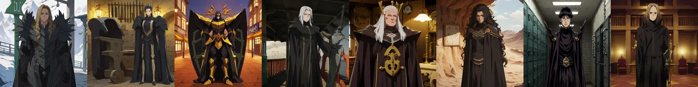 | 66.99 | 8 of 8 | 6 pass, 1 fail, 1 unresolved | 98 | 85 | 2 | 42 | 2.04688 |
| 2 | Fork control, second seed · +12 | 1.5625 |  | 57.01 | 7 of 8 | 6 pass, 2 unresolved | 92 | 72 | 2.1875 | 82 | 2.1875 |
| 3 | Fork with the parent's critic · five cleaner teachers · +48 | 1.46094 | 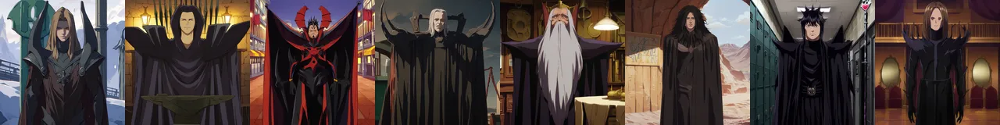 | 56.75 | 7 of 8 | 5 pass, 3 unresolved | 97 | 75 | 1.5625 | 54 | 2.09375 |
| 4 | Exact continuation · +36 | 1.10938 | 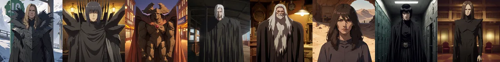 | 53.22 | 7 of 8 | 8 pass | 86 | 74 | 1.10938 | 41 | 1.625 |
| 5 | Fork control, lower generator rate · +48 | 1.34375 | 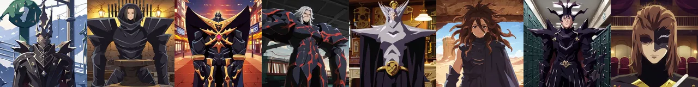 | 49.23 | 6 of 8 | 5 pass, 1 fail, 2 unresolved | 93 | 62 | 1.34375 | 43 | 1.44141 |
| 6 | Fork, lower generator rate · five cleaner teachers · +48 | 1.625 | 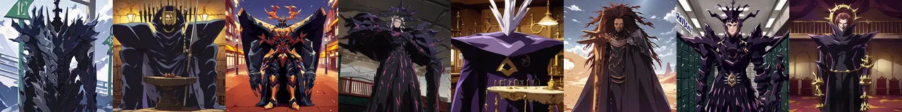 | 49.02 | 6 of 8 | 3 pass, 2 fail, 3 unresolved | 100 | 58 | 1.625 | 57 | 1.95312 |
| 7 | Fork with the parent's critic · five cleaner teachers · +12 | 1.85938 | 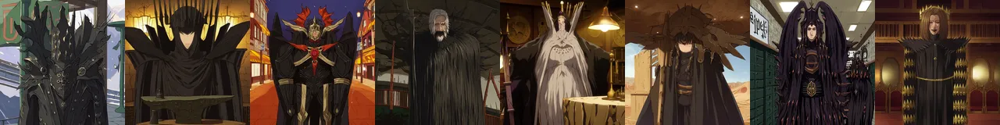 | 48.24 | 7 of 8 | 3 pass, 1 fail, 4 unresolved | 100 | 58 | 2 | 45 | 2.09375 |
| 8 | Fork control with the parent's critic · +12 | 1.38281 |  | 46.65 | 5 of 8 | 4 pass, 1 fail, 3 unresolved | 88 | 63 | 1.5 | 52 | 1.38281 |
| 9 | Fork · five cleaner teachers · +48 | 1.20312 | 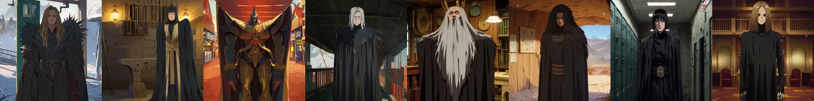 | 46.45 | 4 of 8 | 8 pass | 98 | 56 | 1.25 | 55 | 1.38281 |
| 10 | Parent · no further training | 1.59375 | 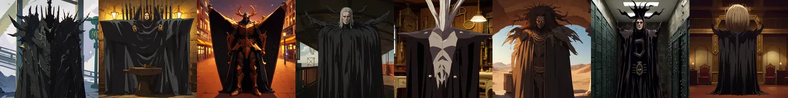 | 46.40 | 5 of 8 | 6 pass, 2 unresolved | 99 | 55 | 1.76562 | 48 | 1.5625 |
| 11 | Fork · five cleaner teachers, second seed · +12 | 1.5625 |  | 46.31 | 5 of 8 | 6 pass, 1 fail, 1 unresolved | 92 | 58 | 2 | 82 | 1.88867 |
| 12 | Fork control with the parent's critic · +48 | 1.34375 |  | 45.97 | 5 of 8 | 3 pass, 5 unresolved | 96 | 56 | 1.34375 | 49 | 1.59375 |
| 13 | Fork · one cleaner teacher · +12 | 1.15625 |  | 45.13 | 4 of 8 | 7 pass, 1 unresolved | 94 | 57 | 1.29688 | 54 | 1.83594 |
| 14 | Exact continuation · +48 | 1.625 | 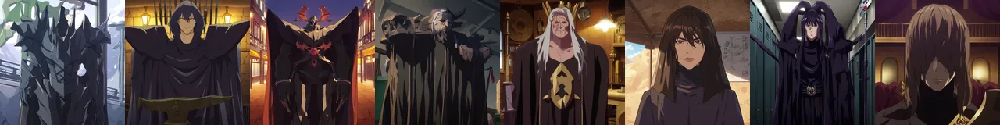 | 43.78 | 5 of 8 | 4 pass, 1 fail, 3 unresolved | 100 | 51 | 1.71875 | 62 | 2 |
| 15 | Fork control · +12 | 1.25 | 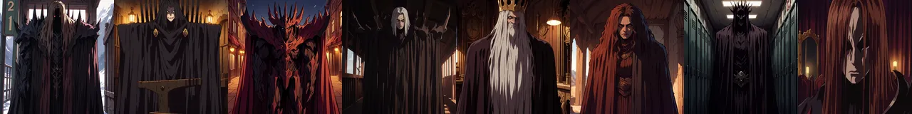 | 42.31 | 5 of 8 | 7 pass, 1 unresolved | 93 | 54 | 1.34375 | 60 | 2 |
| 16 | Fork control · +48 | 1.27344 | 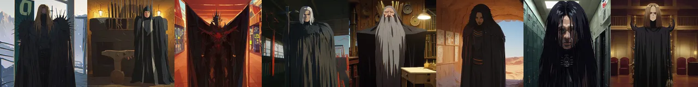 | 38.34 | 5 of 8 | 5 pass, 1 fail, 2 unresolved | 93 | 49 | 1.27344 | 58 | 1.25 |
| 17 | Fork · five cleaner teachers · +12 | 1.20312 | 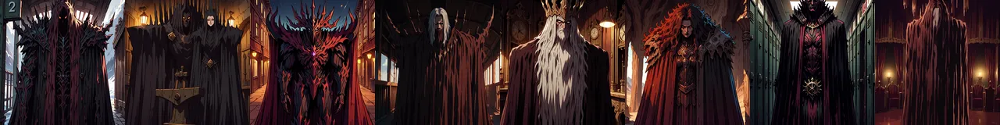 | 26.85 | 2 of 8 | 5 pass, 3 unresolved | 100 | 30 | 1.34375 | 56 | 1.5 |
| 18 | Fork · one cleaner teacher · +36 | 1.25 | 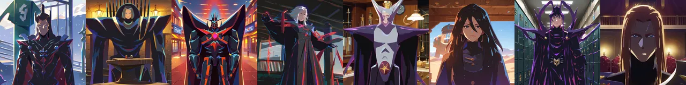 | 18.27 | 1 of 8 | 4 pass, 1 fail, 3 unresolved | 88 | 28 | 1.25 | 70 | 1.27344 |
| 19 | Fork control · +36 | 1.20312 | 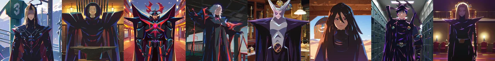 | 16.96 | 1 of 8 | 4 pass, 1 fail, 3 unresolved | 88 | 24 | 1.20312 | 68 | 1.5 |
| 20 | Fork · five cleaner teachers · +36 | 1.15625 | 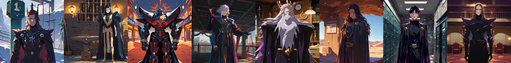 | 16.17 | 1 of 8 | 5 pass, 3 unresolved | 92 | 23 | 1.15625 | 78 | 2.1875 |

The exact continuation at +12 leads with all eight characters working at α 1.38: clean drawings, each person still present, eight different designs in their original scenes. Its violinist has blank eyes, which the structural check fails. The parent ranks tenth, because it only reads as a boss near α 1.6, where its drawing quality has already dropped. The forks that collapsed and the one that shattered are at the bottom. Checkpoint variation is still large: the same continuation scores 66.99, 53.22 and 43.78 at +12, +36 and +48.

Three things about the readers shaped this.

- **A shrunken image hides the defect.** Mercury Decide on a 288-pixel copy read the shattered row at 20 against 8 for clean teachers. On native tiles it read 52 against 6. Jev separates the same sets by 39 against 22.
- **The reader refuses a PNG above about 180 KB.** Busy high-strength images exceeded that with 320-pixel tiles, so the strengths most likely to be broken went unmeasured until every image moved to 256-pixel tiles.
- **Tiles cannot see a missing head.** A clean drawing of a headless robe passed until the whole-figure reading was added.

[Score](../../lumen_studio/study/working_score.py) · [Alpha search](../../research/post-training/working_search.py) · [Readings per image](working-results.json)

## Every trained recipe

All 38 Final Boss arms of the [constant-alpha retest](../leaderboard.md) were searched again by the same score, from their saved search renders, and ranked with the twenty checkpoints above. One arm, the stopped reference-rate repair, has an unanswered ranking reading and is unranked. [Board with every image and reading](http://100.90.104.57:8797/board-leaderboard.html) · [Readings per image](board-results.json)

| Rank | Recipe or checkpoint | Run | Updates | Constant α | Eight held-out characters | Score / 100 | Working | Structural check | Is a boss | Quality | α before |
| ---: | --- | --- | ---: | ---: | --- | ---: | ---: | --- | ---: | ---: | ---: |
| 1 | Exact continuation · same targets · +12 | RAW512 post-training · PG 0.12.0 | 524 | 1.38281 |  | 66.99 | 8 of 8 | 6 pass, 1 fail, 1 unresolved | 98 | 85 | 2.04688 |
| 2 | Fork control, second seed · +12 | RAW512 post-training · PG 0.12.0 | 524 | 1.5625 |  | 57.01 | 7 of 8 | 6 pass, 2 unresolved | 92 | 72 | 2.1875 |
| 3 | Fork with the parent's critic · five least-damaged teachers · +48 | RAW512 post-training · PG 0.12.0 | 560 | 1.46094 |  | 56.75 | 7 of 8 | 5 pass, 3 unresolved | 97 | 75 | 2.09375 |
| 4 | Background-only scene and lighting projection, 0.45 floor | Vibe12 · PG 0.11.1 · completed | 192 | 1.46094 | 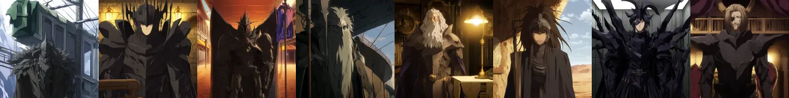 | 53.41 | 6 of 8 | 6 pass, 2 unresolved | 98 | 65 | 2.11719 |
| 5 | Exact continuation · same targets · +36 | RAW512 post-training · PG 0.12.0 | 548 | 1.10938 |  | 53.22 | 7 of 8 | 8 pass | 86 | 74 | 1.625 |
| 6 | Six highest-divergence timestep positions | Vibe12 · PG 0.11.1 · completed | 192 | 1.0625 | 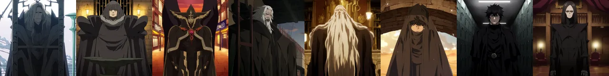 | 51.11 | 6 of 8 | 4 pass, 4 unresolved | 92 | 67 | 1.36328 |
| 7 | Prompt-only control · all 240 fields | Vibe12 · PG 0.11.1 · completed | 192 | 1.34375 |  | 50.77 | 7 of 8 | 4 pass, 3 fail, 1 unresolved | 98 | 63 | 1.59375 |
| 8 | Stronger cues at the first three teacher positions | Vibe12 · PG 0.11.1 · completed | 192 | 1.15625 |  | 49.57 | 5 of 8 | 2 pass, 3 fail, 3 unresolved | 96 | 59 | 1.29688 |
| 9 | Fork control at the lower generator rate · +48 | RAW512 post-training · PG 0.12.0 | 560 | 1.34375 |  | 49.23 | 6 of 8 | 5 pass, 1 fail, 2 unresolved | 93 | 62 | 1.44141 |
| 10 | Fork at the lower generator rate · five least-damaged teachers · +48 | RAW512 post-training · PG 0.12.0 | 560 | 1.625 |  | 49.02 | 6 of 8 | 3 pass, 2 fail, 3 unresolved | 100 | 58 | 1.95312 |
| 11 | Stronger cues at the final three teacher positions | Vibe12 · PG 0.11.1 · completed | 192 | 1.42188 | 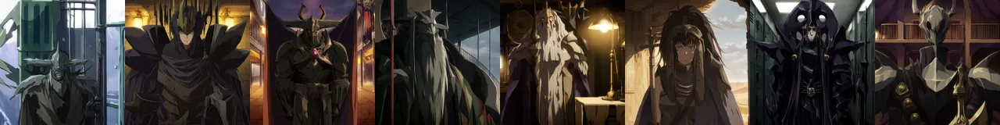 | 48.58 | 5 of 8 | 6 pass, 1 fail, 1 unresolved | 96 | 61 | 1.90625 |
| 12 | Paired scene and lighting contexts, 50% blend, 0.45 floor | Vibe12 · PG 0.11.1 · completed | 192 | 1.38281 | 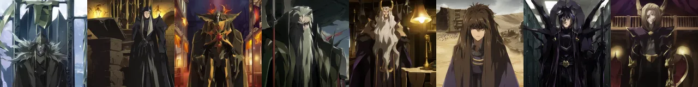 | 48.48 | 4 of 8 | 4 pass, 4 unresolved | 93 | 61 | 1.53125 |
| 13 | Fork with the parent's critic · five least-damaged teachers · +12 | RAW512 post-training · PG 0.12.0 | 524 | 1.85938 |  | 48.24 | 7 of 8 | 3 pass, 1 fail, 4 unresolved | 100 | 58 | 2.09375 |
| 14 | Extra training exposure at the middle four denoising positions | Vibe12 · PG 0.11.1 · completed | 192 | 1.5625 |  | 46.72 | 6 of 8 | 4 pass, 2 fail, 2 unresolved | 93 | 57 | 2.14062 |
| 15 | Fork control with the parent's critic · +12 | RAW512 post-training · PG 0.12.0 | 524 | 1.38281 |  | 46.65 | 5 of 8 | 4 pass, 1 fail, 3 unresolved | 88 | 63 | 1.38281 |
| 16 | Fork · five least-damaged teachers · +48 | RAW512 post-training · PG 0.12.0 | 560 | 1.20312 |  | 46.45 | 4 of 8 | 8 pass | 98 | 56 | 1.38281 |
| 17 | Parent · no further training | RAW512 post-training · PG 0.12.0 | 512 | 1.59375 |  | 46.40 | 5 of 8 | 6 pass, 2 unresolved | 99 | 55 | 1.5625 |
| 18 | Fork, second seed · five least-damaged teachers · +12 | RAW512 post-training · PG 0.12.0 | 524 | 1.5625 |  | 46.31 | 5 of 8 | 6 pass, 1 fail, 1 unresolved | 92 | 58 | 1.88867 |
| 19 | Soft foreground weighting · prior incumbent recipe | Vibe12 · PG 0.11.1 · completed | 192 | 1.25 |  | 46.00 | 6 of 8 | 5 pass, 3 unresolved | 93 | 58 | 1.41406 |
| 20 | Fork control with the parent's critic · +48 | RAW512 post-training · PG 0.12.0 | 560 | 1.34375 |  | 45.97 | 5 of 8 | 3 pass, 5 unresolved | 96 | 56 | 1.59375 |
| 21 | Fork · one cleaner teacher · +12 | RAW512 post-training · PG 0.12.0 | 524 | 1.15625 |  | 45.13 | 4 of 8 | 7 pass, 1 unresolved | 94 | 57 | 1.83594 |
| 22 | Soft foreground weighting plus a 35% blend of two averaged cues | Vibe12 · PG 0.11.1 · completed | 192 | 1.5625 |  | 44.68 | 6 of 8 | 4 pass, 2 fail, 2 unresolved | 95 | 57 | 1.625 |
| 23 | Second qualified seed on the shared teacher scenes | Vibe12 · PG 0.11.1 · completed | 192 | 1.15625 |  | 44.01 | 5 of 8 | 3 pass, 1 fail, 4 unresolved | 85 | 64 | 1.59375 |
| 24 | Exact continuation · same targets · +48 | RAW512 post-training · PG 0.12.0 | 560 | 1.625 |  | 43.78 | 5 of 8 | 4 pass, 1 fail, 3 unresolved | 100 | 51 | 2 |
| 25 | In-scene costume cue blend, 35% | Vibe12 · PG 0.11.1 · completed | 192 | 1.46094 |  | 42.75 | 5 of 8 | 6 pass, 2 unresolved | 87 | 62 | 2.09375 |
| 26 | Fork control · fresh critic, same targets · +12 | RAW512 post-training · PG 0.12.0 | 524 | 1.25 |  | 42.31 | 5 of 8 | 7 pass, 1 unresolved | 93 | 54 | 2 |
| 27 | shared-best-mixed-path | Vibe12 · PG 0.11.1 · training stopped | 192 | 1.46094 |  | 41.93 | 5 of 8 | 1 pass, 3 fail, 4 unresolved | 70 | 65 | 1.67773 |
| 28 | Paired scene and lighting contexts, 50% blend, 0.65 floor | Vibe12 · PG 0.11.1 · completed | 192 | 1.25 |  | 40.13 | 4 of 8 | 4 pass, 4 unresolved | 86 | 50 | 1.39062 |
| 29 | Train on adapter rollout states, 0.45 floor | Vibe12 · PG 0.11.1 · completed | 192 | 1.5625 |  | 39.34 | 5 of 8 | 4 pass, 1 fail, 3 unresolved | 95 | 51 | 2.02344 |
| 30 | Whole-image scene and lighting projection, 0.65 floor | Vibe12 · PG 0.11.1 · completed | 192 | 1.53125 |  | 39.34 | 3 of 8 | 2 pass, 4 fail, 2 unresolved | 97 | 49 | 1.53125 |
| 31 | Fork control · fresh critic, same targets · +48 | RAW512 post-training · PG 0.12.0 | 560 | 1.27344 |  | 38.34 | 5 of 8 | 5 pass, 1 fail, 2 unresolved | 93 | 49 | 1.25 |
| 32 | Percentile-filtered blend at the first three teacher positions | Vibe12 · PG 0.11.1 · completed | 192 | 1.29688 |  | 38.32 | 5 of 8 | 3 fail, 5 unresolved | 85 | 55 | 1.48047 |
| 33 | Qualified costume teachers with soft-foreground contexts | Vibe12 · PG 0.11.1 · completed | 192 | 1.29688 |  | 37.06 | 5 of 8 | 2 pass, 6 unresolved | 92 | 48 | 1.5 |
| 34 | Soft foreground weighting plus 35% stronger Boss cues | Vibe12 · PG 0.11.1 · completed | 192 | 1.0625 |  | 36.47 | 3 of 8 | 5 pass, 3 unresolved | 87 | 52 | 1.22656 |
| 35 | Extra training exposure at the opening four denoising positions | Vibe12 · PG 0.11.1 · completed | 192 | 1.42188 |  | 35.23 | 3 of 8 | 6 pass, 2 unresolved | 80 | 53 | 2.1875 |
| 36 | sparse-full | Vibe12 · PG 0.11.1 · training stopped | 144 | 1.8125 |  | 32.83 | 2 of 8 | 4 pass, 2 fail, 2 unresolved | 88 | 42 | 2 |
| 37 | Six evenly spaced timestep positions | Vibe12 · PG 0.11.1 · completed | 192 | 1.5625 |  | 30.54 | 3 of 8 | 3 pass, 4 fail, 1 unresolved | 97 | 34 | 1.76562 |
| 38 | Soft foreground weighting, 0.45 background floor | Vibe12 · PG 0.11.1 · completed | 192 | 1.625 |  | 29.75 | 1 of 8 | 4 pass, 1 fail, 3 unresolved | 93 | 38 | 1.73047 |
| 39 | Stronger Boss cues contrasted with matched ordinary attire | Vibe12 · PG 0.11.1 · completed | 192 | 1.29688 |  | 29.32 | 3 of 8 | 4 pass, 2 fail, 2 unresolved | 100 | 32 | 1.34375 |
| 40 | Fork · five least-damaged teachers · +12 | RAW512 post-training · PG 0.12.0 | 524 | 1.20312 |  | 26.85 | 2 of 8 | 5 pass, 3 unresolved | 100 | 30 | 1.5 |
| 41 | Soft foreground weighting with subject APG | Vibe12 · PG 0.11.1 · completed | 192 | 1.5625 |  | 23.81 | 3 of 8 | 2 pass, 2 fail, 4 unresolved | 73 | 32 | 1.59375 |
| 42 | Soft foreground weighting with full-strength Boss cues | Vibe12 · PG 0.11.1 · completed | 192 | 1.0625 |  | 23.75 | 2 of 8 | 3 pass, 2 fail, 3 unresolved | 75 | 43 | 1.625 |
| 43 | Neutral trajectory only | Vibe12 · PG 0.11.1 · completed | 192 | 1.76562 |  | 18.88 | 2 of 8 | 1 pass, 5 fail, 2 unresolved | 57 | 39 | 1.90625 |
| 44 | Fork · one cleaner teacher · +36 | RAW512 post-training · PG 0.12.0 | 548 | 1.25 |  | 18.27 | 1 of 8 | 4 pass, 1 fail, 3 unresolved | 88 | 28 | 1.27344 |
| 45 | Fork control · fresh critic, same targets · +36 | RAW512 post-training · PG 0.12.0 | 548 | 1.20312 |  | 16.96 | 1 of 8 | 4 pass, 1 fail, 3 unresolved | 88 | 24 | 1.5 |
| 46 | Fork · five least-damaged teachers · +36 | RAW512 post-training · PG 0.12.0 | 548 | 1.15625 |  | 16.17 | 1 of 8 | 5 pass, 3 unresolved | 92 | 23 | 2.1875 |
| 47 | boss-short | boss-short · PG 0.12.0 · completed | 128 | 2 |  | 12.23 | 2 of 8 | 2 pass, 3 fail, 3 unresolved | 72 | 25 | 2.02344 |
| 48 | boss-short | boss-short · PG 0.12.0 · training stopped | 32 | 0.5 |  | 0.22 | 0 of 8 | 8 pass | 0 | 88 | 0.90625 |
| 49 | boss-32 | boss-32 · PG 0.12.0 · completed | 16 | 0.5 |  | 0.00 | 0 of 8 | 8 pass | 0 | 87 | 1.40625 |
| 50 | boss-late-cue-repair | boss-late-cue-repair · PG 0.12.0 · completed | 128 | 0.5 |  | 0.00 | 0 of 8 | 8 pass | 0 | 85 | 1.90625 |
| 51 | boss-pair-repair | boss-pair-repair · PG 0.12.0 · completed | 96 | 0.5 |  | 0.00 | 0 of 8 | 8 pass | 0 | 86 | 1.65625 |
| 52 | boss-short | boss-short · PG 0.12.0 · rate screen only | 32 | 0.5 |  | 0.00 | 0 of 8 | 8 pass | 0 | 87 | 1.73047 |
| 53 | boss-short | boss-short · PG 0.12.0 · rate screen only | 32 | 0.5 |  | 0.00 | 0 of 8 | 8 pass | 0 | 80 | 2 |
| 54 | boss-short | boss-short · PG 0.12.0 · rate screen only | 32 | 0.5 |  | 0.00 | 0 of 8 | 8 pass | 0 | 83 | 1.59375 |
| 55 | boss-short | boss-short · PG 0.12.0 · rate screen only | 32 | 0.3125 |  | 0.00 | 0 of 8 | 8 pass | 0 | 86 | 0.84375 |
| 56 | boss-short | boss-short · PG 0.12.0 · training stopped | 64 | 0.375 |  | 0.00 | 0 of 8 | 8 pass | 0 | 79 | 1.15625 |
| 57 | Late-cues version control | version-probe · PG 0.12.0 · version control | 48 | 0.75 |  | 0.00 | 0 of 8 | 7 pass, 1 fail | 0 | 76 | 1.53125 |

**No recipe is separated from the others by more than one checkpoint's variation.** The six best 192-update recipes score 48.5 to 53.4: background-only projection, highest-divergence positions, the prompt-only control, early cues, late cues and paired contexts. The exact continuation of one RAW scores 66.99, 53.22 and 43.78 at three nearby checkpoints. A single RAW per recipe cannot rank these six.

**The prompt-only control is among the leaders.** It ranks third of the 192-update recipes at 50.77 with seven of eight working. The cue, matte and projection recipes built on it do not beat it by a margin this board can see. Three of its images fail the structural check.

**Some recipes are clearly worse.** Neutral trajectory only scores 18.88, full-strength Boss cues 23.75 and subject APG 23.81. Evenly spaced positions, the 0.45 floor alone and matched attire score about 30.

**Short training never makes a boss.** Every arm with 128 updates or fewer scores under 13, and nine of them score zero at every strength. They read as ordinary characters with clean drawings.

**The earlier leader is mid-table.** Late cues led the distinct Boss board at α 1.91. Here it picks α 1.42 and ranks fifth of the 192-update recipes at 48.58.

## Ranked by the distinct Boss score

| Rank | Approach | Updates | Constant α | Eight ranking characters | Distinct Boss / 100 | Boss gain | Damage | Repeat | Integrity | Training |
| ---: | --- | ---: | ---: | --- | ---: | ---: | ---: | ---: | --- | --- |
| — | Matched baseline | — | OFF |  | — | — | — | — | — | — |
| 1 | Fork · five least-damaged teachers, gain not protected · +12 | 524 | 1.5 | 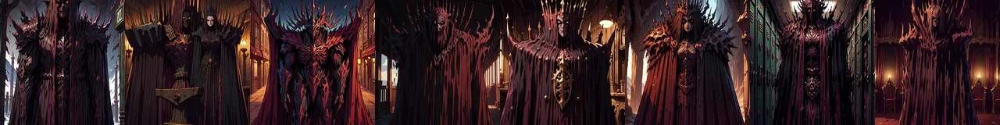 | 30.83 | +80.2 | 27.3 | 55.0 | 3 pass, 1 fail, 4 unresolved | completed |
| 2 | Fork control with the parent's trained critic · same targets · +48 | 560 | 1.59375 | 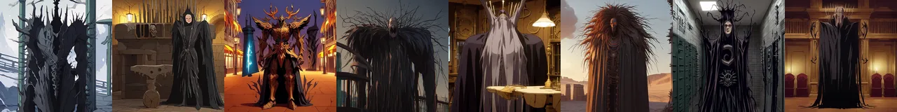 | 30.22 | +78.2 | 27.9 | 44.7 | 3 pass, 2 fail, 3 unresolved | completed |
| 3 | Fork, second seed · five least-damaged teachers · +12 | 524 | 1.88867 | 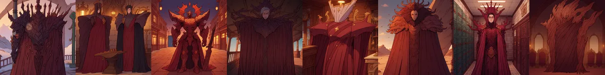 | 29.49 | +75.6 | 22.0 | 42.3 | 7 pass, 1 unresolved | completed |
| 4 | Exact continuation · parent critic and optimizer, same targets · +12 | 524 | 2.04688 | 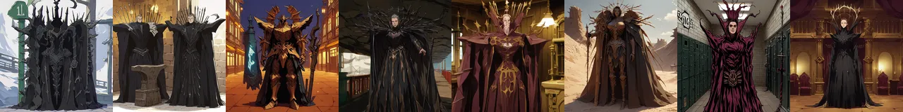 | 29.41 | +79.1 | 28.3 | 51.9 | 6 pass, 1 fail, 1 unresolved | completed |
| 5 | Exact continuation · parent critic and optimizer, same targets · +36 | 548 | 1.625 | 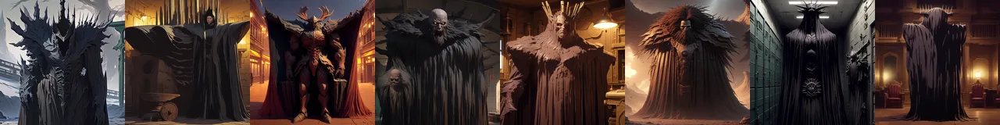 | 28.87 | +77.9 | 29.0 | 48.1 | 6 pass, 2 fail | completed |
| 6 | Fork with the parent's trained critic · five least-damaged teachers · +12 | 524 | 2.09375 | 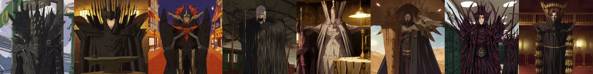 | 28.36 | +76.9 | 27.9 | 46.2 | 2 pass, 2 fail, 4 unresolved | completed |
| 7 | Parent · no further training | 512 | 1.5625 | 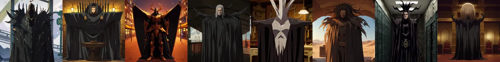 | 27.39 | +74.6 | 25.2 | 42.9 | 6 pass, 2 unresolved | parent |
| 8 | Fork at the lower generator rate · five least-damaged teachers · +48 | 560 | 1.95312 | 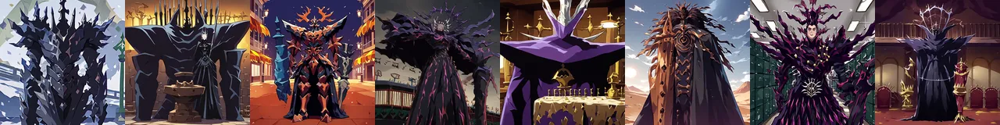 | 27.34 | +76.5 | 29.5 | 46.5 | 1 pass, 1 fail, 6 unresolved | completed |
| 9 | Fork control at the lower generator rate · same targets · +48 | 560 | 1.44141 | 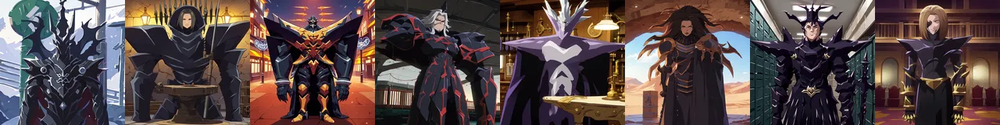 | 27.03 | +75.2 | 27.2 | 41.9 | 5 pass, 3 unresolved | completed |
| 10 | Fork with the parent's trained critic · five least-damaged teachers · +48 | 560 | 2.09375 | 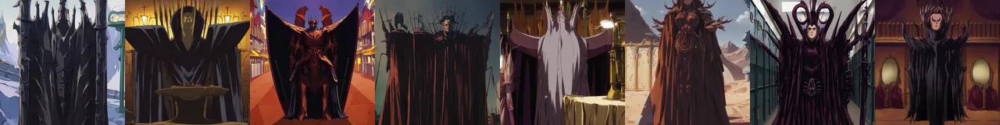 | 25.28 | +74.2 | 28.4 | 47.9 | 2 pass, 1 fail, 5 unresolved | completed |
| 11 | Fork control, second seed · same targets · +12 | 524 | 2.1875 | 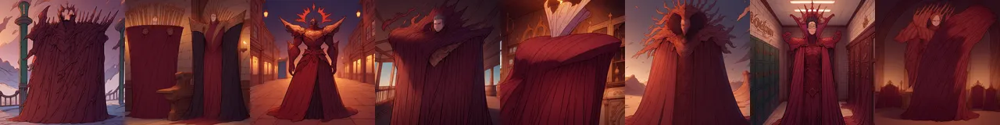 | 25.23 | +70.0 | 23.3 | 54.7 | 6 pass, 1 fail, 1 unresolved | completed |
| 12 | Fork control · fresh critic and optimizer, same targets · +36 | 548 | 1.5 | 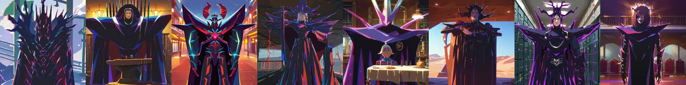 | 24.55 | +76.1 | 33.4 | 54.9 | 1 pass, 7 unresolved | completed |
| 13 | Fork control with the parent's trained critic · same targets · +12 | 524 | 1.38281 | 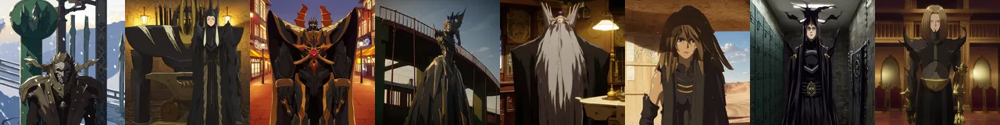 | 24.25 | +68.1 | 27.3 | 33.9 | 3 pass, 1 fail, 4 unresolved | completed |
| 14 | Fork · five least-damaged teachers, gain not protected · +36 | 548 | 2.1875 |  | 24.21 | +77.1 | 33.9 | 58.5 | 0 pass, 2 fail, 6 unresolved | completed |
| 15 | Fork · five least-damaged teachers, gain not protected · +48 | 560 | 1.38281 | 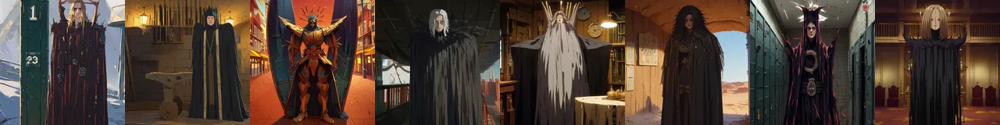 | 24.06 | +73.8 | 29.5 | 45.2 | 3 pass, 5 unresolved | completed |
| 16 | Fork · one cleaner teacher that keeps its Boss gain · +36 | 548 | 1.27344 | 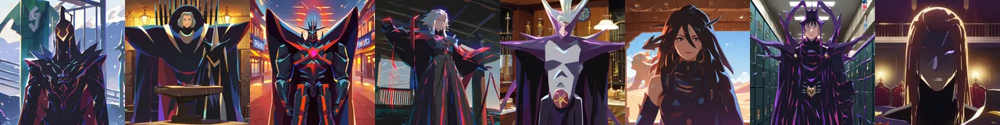 | 23.96 | +71.1 | 30.9 | 36.0 | 3 pass, 1 fail, 4 unresolved | stopped at +36 · structural failure |
| 17 | Exact continuation · parent critic and optimizer, same targets · +48 | 560 | 2 | 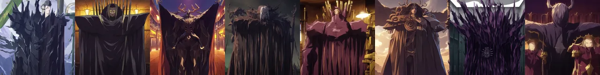 | 23.64 | +73.2 | 28.6 | 47.9 | 1 pass, 7 unresolved | completed |
| 18 | Fork control · fresh critic and optimizer, same targets · +12 | 524 | 2 | 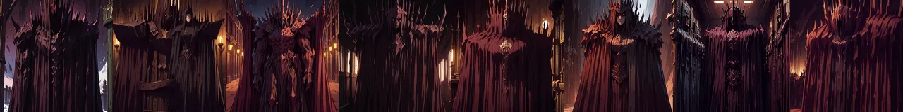 | 20.98 | +71.8 | 27.3 | 69.7 | 1 pass, 2 fail, 5 unresolved | completed |
| 19 | Fork control · fresh critic and optimizer, same targets · +48 | 560 | 1.25 | 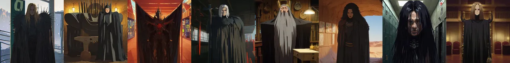 | 20.27 | +69.1 | 29.3 | 43.3 | 4 pass, 2 fail, 2 unresolved | completed |

The rows include every measured checkpoint, with the saved +12 and +36 quarters. A structural failure on any ranking image keeps a RAW out of release whatever its score. The one-teacher fork's +12 ranking is unmeasured because one of its 56 repeated-design judgments returned no answer. It selected α 1.8359375 with +73.8 Boss gain.

## What each arm changed

| Arm | Entry | Critic and optimizers | Targets | Generator rate |
| --- | --- | --- | --- | ---: |
| Exact continuation | resume the parent FULL512 | the parent's own | unchanged | 0.00075 |
| Fork control | fork the parent RAW512 | fresh, seed 1 | unchanged | 0.00075 |
| One cleaner teacher | fork | fresh, seed 1 | 1 of 12 scenes replaced | 0.00075 |
| Five least-damaged teachers | fork | fresh, seed 1 | 5 of 12 scenes replaced | 0.00075 |
| Second-seed pair | fork | fresh, seed 2 | unchanged and 5 replaced | 0.00075 |
| Trained-critic pair | fork | parent's critic weights, fresh optimizers | unchanged and 5 replaced | 0.00075 |
| Lower-rate pair | fork | fresh, seed 1 | unchanged and 5 replaced | 0.0002109375 |

The proposal names a fork control and a cleaner-target fork. The exact continuation, the second teacher rule, the second seed, the lower rate and the trained critic were added during the run to explain what the first two showed.

## Findings

**Cleaner teachers added effect and left damage where it was.** Each five-teacher arm has a control that differs only in its targets. Over the seven pairs the five-teacher arm scored +9.8, +4.3, +4.1, −0.3, +3.8, +0.3 and −4.9 points against its control. Its damage differed by 0.0, −1.2, +0.5, +0.5, +0.2, +2.3 and +0.4. The replacement teachers were chosen for lower damage and measured lower Boss gain than the ones they replaced, and the student moved the other way.

**Damage rose with post-training.** In the paired comparison on the eight ranking characters, damage rose over the parent in sixteen of eighteen post-trained RAWs, by 2.0 to 8.7 points. The two exceptions are the second-seed forks at +12, at −1.9 for unchanged targets and −3.2 for the five cleaner teachers. That five-teacher fork is the one Pareto improvement over the parent, with +1.0 gain, seven structural checks passing and one unresolved. The proposal's bar is five damage points. Its control on unchanged targets also lowered damage, so the seed explains more of it than the teachers do.

**Forks that restart the critic collapse toward one design.** A fork inherits the adapter and particle bank. An untrained critic first pushes the trained generator in one common direction. Repeated design over the 28 character pairs is 42.9 for the parent. At +12 it is 69.7 and 54.7 for the two fork controls and 55.0 for the first five-teacher fork, whose eight characters all become the same crimson spiked figure in a reddened scene. The second five-teacher fork measures 42.3, yet its images share one crimson palette, its smith shows two figures and its violinist no longer shows a person. Forks that carry the parent's trained critic measure 33.9 and 46.2 at +12 and 44.7 and 47.9 at +48, and their α 1 scores stay within 0.8 to 6.7 where the first cold forks jumped to 13.7 and 19.5.

**The trained critic did not make cleaner teachers win.** With the parent's critic, unchanged targets ranked 24.25 at +12 and 30.22 at +48. The five teachers ranked 28.36 and 25.28. Both arms measure 27.3 to 28.4 damage.

**Checkpoint variation is as large as these differences.** The exact continuation keeps the parent's critic, optimizer state, random streams and targets. It ranked 29.41 at +12, 28.87 at +36 and 23.64 at +48. The fork control ranked 20.98, 24.55 and 20.27. The five-teacher fork ranked 30.83, 24.21 and 24.06. No arm has more than two seeds.

**The published generator rate is too high for a short second stage.** At α 1 on the four training-selection characters the parent scores 2.5. The continuation then read 1.4, 4.8, 13.3 and 3.1 over four quarters, and the fork control 13.7, 4.4, 6.3 and 2.9. At G 0.0002109375 the fork control read 2.9, 2.9, 3.1 and 1.5 and passed every structural check. After 48 updates at that rate the fork control ranked 27.03 and the five-teacher fork 27.34, both level with the parent. The cleaner teachers did not lower damage there: 29.5 against the control's 27.2. The lower rate holds the parent's quality and moves too little in 48 updates to show a target effect.

**48 updates is a small dose.** The batch holds two fields, so 48 updates show the generator 96 of the 240 fields. A scene's twenty fields receive about eight visits. The parent had 1,024.

**One arm stopped.** The one-teacher fork produced a structural failure at +36 on the watchmaker screening scene, where hair, beard and cloak merged into one mass (broken structure 0.80). The trainer stopped it before another update. Its +36 RAW ranks 23.96 as a diagnostic.

**At matched effect, the best gap is under the proposal's bar.** On the four search characters the parent's chosen strength gives +74.0 gain at 27.7 damage. The least damaged searched strength within two gain points was 23.5 and 23.6 for the two five-teacher forks at +12, and 24.2 and 24.3 for the continuation at +36 and +12. The proposal asks for five points. The cleaner-target forks and the unchanged-target continuation are within one point of each other.

## What the damage question measures

The damage question reads 19.9 on the eight unedited OFF images, so only the part above that floor can be removed. Above it, the twelve current teachers add 2.1 points, the parent adds 5.7 and the collapsed forks add 7.4 to 7.9. The proposal's five-point bar asks for nearly all of the parent's removable damage, and the question hardly separates a collapsed row from the parent.

The structural check is already read on every ranked image as a pass or fail gate. Taken as a graded reading above the matched OFF image, it separates the same sets by much more.

| Images | Boss gain | Damage now | Damage above OFF | Structure above OFF | Scene overwritten |
| --- | ---: | ---: | ---: | ---: | ---: |
| Current teachers, 12 | +75.2 | 23.1 | 2.1 | 4.0 | 65.0 |
| Teacher proposals, 18 | +61.4 | 21.4 | 0.8 | 9.2 | 58.6 |
| Parent | +74.6 | 25.2 | 5.7 | 15.2 | 59.5 |
| Lower-rate fork control, +48 | +75.2 | 27.2 | 7.2 | 16.5 | 62.6 |
| Exact continuation, +12 | +79.1 | 28.3 | 8.6 | 16.6 | 65.2 |
| Second five-teacher fork, +12 | +75.6 | 22.0 | 2.5 | 14.0 | 68.8 |
| First five-teacher fork, +12, collapsed | +80.2 | 27.3 | 7.4 | 27.0 | 72.5 |
| Fork control, +12, collapsed | +71.8 | 27.3 | 7.9 | 38.4 | 81.0 |

Structure above OFF is the largest of the three structural readings minus the same reading on the matched OFF image. The current teachers read 4.0, so the targets are clean on this scale and the parent's 15.2 is the student's own. The proposals chosen for lower damage read 9.2, worse than the teachers they replaced, which fits their failure to help. The paired question about how much of the scene the edit overwrote reads 65.0 on the base-model teachers themselves, so it describes how the teachers were made and not a student defect.

Rescoring each row at its kept alpha with this reading in place of the damage question moves the collapsed first five-teacher fork from first to third and the parent from seventh to fifth. The formula multiplies by one minus damage, which is a weak term beside the cubed Boss distinction. [Readings per image and rescored rows](../../research/post-training/damage_definition.py)

## The teachers

All 24 archived teacher images replayed byte for byte from their prompts and seeds. The twelve current Boss teachers measure 18.2 to 30.0 damage and +69 to +81 gain. The tea-shop teacher fails the existing separate-figure check: it keeps the seated woman and adds an armored figure behind her.

The six most damaged scenes received three proposals each, written for solid shapes and plain silhouettes, rendered from the same neutral prompt and seed. Fourteen of the eighteen proposals measured less damage than the teacher they would replace, down to 18.0. Only one also matched its gain. That is the proposal's rule, and it replaced the tea-shop teacher alone. The elaborate designs that score highest for Boss distinction are the same designs the damage question marks down, so the rule asks for something these proposals rarely have.

The second rule keeps the least damaged single-figure proposal without protecting gain. It replaced five scenes. The librarian kept its teacher because no proposal measured lower.

Replacement rebuilds the positive trajectory and the late-cues transformation for the changed scenes and keeps the neutral trajectory, seed, matte and row order. Every unchanged scene was regenerated through the same code and reproduced the parent's 20 fields bit for bit.

## The fork

`open_training(mode="fork", fork=<parent RAW pin>)` validates the RAW hash, its scoped sidecar and native export record, including model identity, raw selection and disabled EMA. It loads the parent tensors strictly before the optimizers exist. The critic is the one a fresh cohort with that seed starts with, or the parent's trained critic when `critic_from` pins the parent FULL. The child counts its own updates from zero and records the inherited 512 in its receipt and in each RAW sidecar. A child FULL resumes through the existing exact path.

On this checkpoint each child began with all 4,033 parent tensors. Before its first update each child drew the parent's eight ranking images at α 1.5625 and all eight OFF images byte for byte. The software tests cover tensor equality, the fresh critic and optimizer state, refusal of averaged or mismatched parents before any component is built, and reproduction of the next update after reopening a child FULL.

The parent FULL binds the trainer source that wrote it. The exact continuation therefore ran from the parent study's own checkout, and the forks ran from this branch.

## What to change in the proposal

1. **Change what the teacher rule optimizes.** Teachers picked for lower damage did not lower student damage in seven pairs. On the parent's four search characters damage reads 17.9 at α 0.5, about 20 at α 1 and 27 to 31 from α 1.25 upward. A nearly unedited image already reads about 18, as do the cleanest teacher proposals, so roughly ten points are removable at the chosen strength and the five-point bar asks for half of them. The damage arrives between α 1 and α 1.25. A teacher set that reaches the parent's effect below that strength is the candidate that would move it.
2. **Carry the parent's critic into every fork.** `open_training(mode="fork", critic_from=<parent FULL>)` does this. A fork from a RAW alone restarts the critic and collapses.
3. **Choose the rate and budget together.** At 0.00075 a checkpoint is not a stable estimate of its arm beyond a few updates. At 0.0002109375 quality holds, and 48 updates show the generator only 96 of the 240 fields. A lower-rate second stage needs at least 120 updates, one pass over every field.
4. **Use the exact continuation as the equal-update control whenever the parent FULL exists.** Keep the fork control beside it to price the restart of critic and optimizer state.
5. **Run several seeds per arm and fix the checkpoint rule first.** The first seed's +12 jump at α 1 did not recur with the second seed, and +48 was the worst checkpoint in three of four arms.
6. **Give the teacher rule the same tolerance as the outcome rule.** Requiring gain at least equal to the current teacher rejected a proposal that measured 0.01 lower in gain and 0.10 lower in damage.
7. **Search one constant alpha.** The proposal lists constant, early and late schedules. The Anima leaderboard uses one constant strength for all ten steps.
8. **Build the fresh confirmation panel before claiming a win.** These rows use the board's four search and eight ranking characters, which are development cases.

The narrower arm that replaces teacher velocities at the final three positions was not run. It needs a cache layout whose native admission recomputes two teachers per scene.

## Reproduce

[Scripts, policy and the eighteen proposals](../../research/post-training/README.md). The campaign directory is `/ml2/particlesliders-working/anima-final-boss-post-training-20261126`. It holds every arm's FULL and RAW checkpoints, update receipts, renders, Jev receipts and alpha probes. The parent study was read only.
